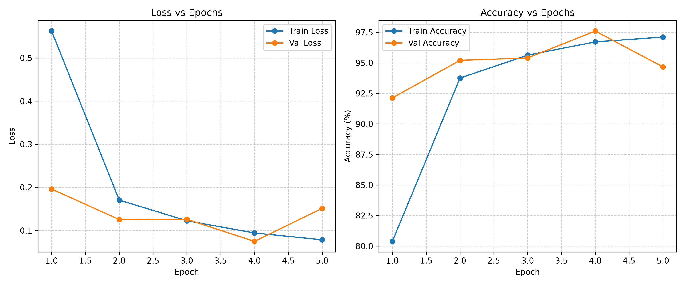

# Animal Image Classification using PyTorch (CNN)

A deep learning project implementing a Convolutional Neural Network (CNN) in PyTorch to classify animal images into three distinct categories: **Cat**, **Dog**, and **Wild Animal**.

---

## 📌 Problem Statement

Image classification is a fundamental problem in computer vision. The objective of this project is to build and train an end-to-end deep learning pipeline that can accurately distinguish between cats, domestic dogs, and wild animals from facial images.

---

## 📂 Dataset Details

The dataset follows the **Animal Faces (AFHQ)** format and is organized into training and validation directories:

```text
├── train/
│   ├── cat/       (~5,150 images)
│   ├── dog/       (~4,740 images)
│   └── wild/      (~4,740 images)
└── val/
    ├── cat/       (500 images)
    ├── dog/       (500 images)
    └── wild/      (500 images)
```

* **Total Training Images:** ~14,630
* **Total Validation Images:** 1,500
* **Classes:** `cat`, `dog`, `wild`
* **Dataset Source:** Animal Faces HQ (AFHQ) / Kaggle Animal Faces Classification Dataset.

---

## 🧠 Model Architecture

The model is built using a custom 4-block Convolutional Neural Network (`SimpleCNN`) implemented in PyTorch:

* **Conv Block 1:** `Conv2d(3 -> 32, kernel=3, pad=1)` + `BatchNorm2d` + `ReLU` + `MaxPool2d(2, 2)`
* **Conv Block 2:** `Conv2d(32 -> 64, kernel=3, pad=1)` + `BatchNorm2d` + `ReLU` + `MaxPool2d(2, 2)`
* **Conv Block 3:** `Conv2d(64 -> 128, kernel=3, pad=1)` + `BatchNorm2d` + `ReLU` + `MaxPool2d(2, 2)`
* **Conv Block 4:** `Conv2d(128 -> 128, kernel=3, pad=1)` + `BatchNorm2d` + `ReLU` + `MaxPool2d(2, 2)`
* **Classifier:**
  * Flatten (`128 * 8 * 8 = 8192`)
  * `Dropout(p=0.3)`
  * `Linear(8192 -> 256)` + `ReLU`
  * `Linear(256 -> 3)` (Logits for Cat, Dog, Wild)

### Data Preprocessing & Augmentation
* **Training Augmentations:** Resize to $128 \times 128$, Random Horizontal Flip, Random Rotation ($\pm 10^\circ$), Normalization using ImageNet mean and std.
* **Validation:** Resize to $128 \times 128$, Normalization.
* **Loss Function:** Cross-Entropy Loss (`nn.CrossEntropyLoss`).
* **Optimizer:** Adam optimizer (`lr=0.001`).

---

## 📁 Project Structure

```text
CNN_Image_Classification_AnirudhaKolay/
├── train.py                # Main script for data loading, model definition, training & plotting
├── predict.py              # Script for running inference on single test images
├── requirements.txt        # Python package dependencies
├── .gitignore              # Ignores dataset, virtualenv, and system cache
├── training_curves.png     # Saved loss and accuracy curves (generated after training)
├── best_model.pth          # Saved PyTorch model checkpoint (generated after training)
└── README.md               # Project documentation
```

---

## 🚀 Setup & Installation

### 1. Clone the Repository
```bash
git clone https://github.com/anirudhakolay/CNN_Image_Classification_AnirudhaKolay.git
cd CNN_Image_Classification_AnirudhaKolay
```

### 2. Create and Activate a Virtual Environment
```bash
# macOS / Linux
python3 -m venv venv
source venv/bin/activate

# Windows
python -m venv venv
venv\Scripts\activate
```

### 3. Install Dependencies
```bash
pip install -r requirements.txt
```

---

## 🏋️‍♂️ How to Run

### 1. Train the Model
To start training the CNN on your dataset:
```bash
python train.py
```

You can also customize the hyperparameters using command-line arguments:
```bash
python train.py --epochs 5 --batch_size 64 --lr 0.001
```

* Hardware acceleration is selected automatically:
  * Apple Silicon GPU (`mps`) on macOS
  * CUDA GPU on Windows/Linux (if available)
  * CPU (fallback)
* The best model weights are automatically saved to `best_model.pth`.
* Loss and accuracy progression graphs are saved as `training_curves.png`.

---

### 2. Predict on an Image
You can test the trained model on any image from the validation set or your own picture:
```bash
python predict.py val/cat/flickr_cat_000001.jpg
```

**Example Output:**
```text
=============================================
Image: val/cat/flickr_cat_000001.jpg
Prediction: CAT
Confidence: 97.85%
---------------------------------------------
Class Probabilities:
  - cat  : 97.85%
  - dog  : 1.42%
  - wild : 0.73%
=============================================
```

---

## 📊 Training Results (5 Epochs on Apple Silicon M4)
* **Final Training Accuracy:** 97.11%
* **Best Validation Accuracy:** **97.60%**
* **Training Time:** ~4.2 minutes total (~50 seconds / epoch using PyTorch Apple Silicon MPS)
* **Epoch-wise Progression:**
  * Epoch 1: Train Acc: 80.38% | Val Acc: 92.13%
  * Epoch 2: Train Acc: 93.75% | Val Acc: 95.20%
  * Epoch 3: Train Acc: 95.63% | Val Acc: 95.40%
  * Epoch 4: Train Acc: 96.71% | Val Acc: 97.60% (Best Checkpoint Saved)
  * Epoch 5: Train Acc: 97.11% | Val Acc: 94.67%



---

## 🛠 Tech Stack
* **Language:** Python 3.10+
* **Framework:** PyTorch & Torchvision
* **Visualization:** Matplotlib
* **Image Processing:** Pillow

